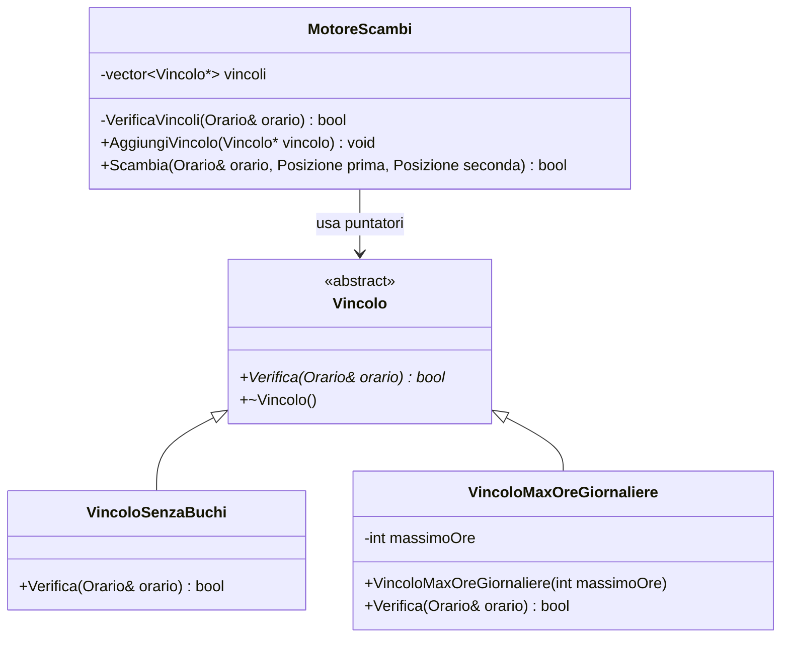

# P2 — Ereditarietà, classi astratte e polimorfismo

**Dispensa teorica per gli studenti — quarta Informatica**  
**Progetto di riferimento:** [OrarioDocenteCPP_P2](../../OrarioDocenteCPP_P2/)  
**Prerequisiti:** classi e oggetti, attributi e metodi, puntatori, riferimenti, `std::vector`, gestione della memoria.

## 1. Il problema: aggiungere nuovi controlli

Nella P1 il motore degli scambi utilizza direttamente `ValidatoreOrario::SenzaBuchi()`. Il controllo funziona, ma cosa succede se vogliamo aggiungere anche un limite alle ore di lezione giornaliere?

Una prima idea è aggiungere al motore una chiamata per ogni controllo. Il problema è che **ogni nuovo vincolo richiederebbe di modificare il motore**.

Nella P2 scegliamo un'altra soluzione: tutti i vincoli avranno un metodo con lo stesso nome, `Verifica()`. Il motore potrà chiamarlo senza conoscere il tipo preciso del vincolo.

## 2. Una classe generale: Vincolo

```cpp
#pragma once
#include "../Model/Orario.h"

class Vincolo {
public:
    virtual bool Verifica(Orario& orario) = 0;
    virtual ~Vincolo() {}
};
```

`Vincolo` è una **classe astratta**: descrive un comportamento comune, ma non fornisce direttamente l'algoritmo di verifica.

La dichiarazione:

```cpp
virtual bool Verifica(Orario& orario) = 0;
```

contiene tre elementi importanti:

- `virtual`: il metodo può avere comportamenti diversi nelle classi derivate;
- `= 0`: il metodo è **virtuale puro** e rende astratta la classe;
- `bool`: ogni verifica restituisce `true` se il vincolo è rispettato, `false` altrimenti.

Non possiamo scrivere `Vincolo v;`, perché una classe astratta non può essere istanziata direttamente.

Il distruttore `virtual ~Vincolo() {}` permette una corretta distruzione di oggetti derivati anche quando vengono eliminati attraverso un puntatore alla classe base. **Nel nostro motore, però, i vincoli non vengono eliminati con `delete`**, perché non sono di sua proprietà.

## 3. Ereditarietà: i vincoli specifici

Una classe derivata eredita l'interfaccia della classe base e realizza il controllo richiesto.

```cpp
class VincoloSenzaBuchi : public Vincolo {
public:
    bool Verifica(Orario& orario) override;
};
```

La scrittura `: public Vincolo` significa che `VincoloSenzaBuchi` deriva da `Vincolo`.

`override` indica che stiamo **ridefinendo** un metodo virtuale della classe base. Il compilatore controlla che la firma sia corretta.

Un'altra classe derivata può avere un algoritmo differente:

```cpp
class VincoloMaxOreGiornaliere : public Vincolo {
private:
    int massimoOre;
public:
    VincoloMaxOreGiornaliere(int massimoOre);
    bool Verifica(Orario& orario) override;
};
```

La prima classe controlla che non ci siano ore vuote **fra due lezioni dello stesso giorno**; la seconda conta le lezioni di ogni giorno e verifica che non superino `massimoOre`.

Entrambe sono vincoli, ma risolvono problemi differenti.

## 4. Il diagramma UML



La freccia con il triangolo vuoto indica **ereditarietà**: il triangolo punta verso la classe base. Il motore mantiene un collegamento ai vincoli registrati, ma non li possiede.

## 5. Polimorfismo: stessa chiamata, comportamenti diversi

Possiamo utilizzare un puntatore alla classe base per indicare un oggetto derivato:

```cpp
VincoloSenzaBuchi senzaBuchi;
VincoloMaxOreGiornaliere massimo(7);

Vincolo* primo = &senzaBuchi;
Vincolo* secondo = &massimo;

bool esito1 = primo->Verifica(orario);
bool esito2 = secondo->Verifica(orario);
```

Entrambi i puntatori hanno tipo `Vincolo*`, ma la chiamata `Verifica()` esegue il metodo dell'**oggetto effettivo**: nel primo caso il controllo dei buchi, nel secondo quello del massimo di ore.

Questo comportamento si chiama **polimorfismo**.

Il motore sfrutta questa proprietà con un vettore:

```cpp
std::vector<Vincolo*> vincoli;
```

e con un ciclo:

```cpp
for (int i = 0; i < static_cast<int>(vincoli.size()); i++) {
    if (!vincoli[i]->Verifica(orario))
        return false;
}
```

Non è necessario chiedere quale classe concreta sia contenuta nel puntatore: la chiamata virtuale sceglie il metodo corretto.

## 6. Proprietà e durata degli oggetti

Nel prototipo P2 la console contiene i vincoli come attributi:

```cpp
VincoloSenzaBuchi vincoloSenzaBuchi;
VincoloMaxOreGiornaliere vincoloMaxOre;
MotoreScambi motore;
```

Nel costruttore registra i loro indirizzi:

```cpp
motore.AggiungiVincolo(&vincoloSenzaBuchi);
motore.AggiungiVincolo(&vincoloMaxOre);
```

Il `vector<Vincolo*>` contiene **puntatori non proprietari**: il motore usa gli oggetti, ma non li distrugge. I vincoli devono restare vivi durante tutte le verifiche.

La differenza rispetto alla matrice `Tessera*` è importante: `Orario` possiede le tessere inserite correttamente, mentre `MotoreScambi` **non possiede** i vincoli.

## 7. Uno scambio deve lasciare l'orario coerente

Il motore segue questa sequenza:

1. Controlla che le due posizioni siano valide e diverse.
2. Verifica che l'orario di partenza rispetti tutti i vincoli.
3. Scambia temporaneamente le celle.
4. Ripete le verifiche.
5. Se tutti i controlli riescono, conferma lo scambio; altrimenti **scambia nuovamente le stesse celle**, tornando alla situazione iniziale.

Il programma deve quindi rispettare questa regola:

> **Uno scambio rifiutato non modifica l'orario.**

Un motore senza vincoli registrati, nella nostra P2, non autorizza scambi.

## 8. Perché questa soluzione è migliore?

| Nella P1 | Nella P2 |
|---|---|
| Il motore conosce un validatore preciso | Il motore conosce soltanto la classe base `Vincolo` |
| Aggiungere controlli richiede modifiche al motore | Un nuovo controllo può essere una nuova classe derivata |
| Un controllo principale | Più controlli eseguiti nello stesso ciclo |
| Nessuna ereditarietà | Ereditarietà e polimorfismo |

**Attenzione:** il polimorfismo non elimina la necessità di progettare bene le regole. Ogni classe derivata deve avere una responsabilità chiara e fornire un risultato verificabile.

## 9. Domande di ripasso

1. Perché `Vincolo` è una classe astratta?
2. Che differenza c'è tra `virtual`, `= 0` e `override`?
3. Perché un `Vincolo*` può puntare a un `VincoloSenzaBuchi`?
4. Come fa il motore a eseguire controlli differenti usando sempre `Verifica()`?
5. Chi possiede gli oggetti vincolo nel programma P2?
6. Perché il motore deve ripristinare le celle quando un controllo fallisce?

**Per approfondire nel codice:** [Vincolo.h](../../OrarioDocenteCPP_P2/Engine/Vincolo.h), [MotoreScambi.cpp](../../OrarioDocenteCPP_P2/Engine/MotoreScambi.cpp), [VincoloSenzaBuchi.cpp](../../OrarioDocenteCPP_P2/Engine/VincoloSenzaBuchi.cpp).

## Aggiornamento: identificare il vincolo violato

Nel prototipo P2 aggiornato, `Vincolo` dichiara anche `virtual std::string GetMessaggio() = 0;`. Ogni classe derivata implementa questo metodo e restituisce un messaggio descrittivo. `MotoreScambi::Scambia` mantiene il risultato `bool`, ma riceve anche `std::string& messaggio`: se una verifica fallisce, `VerificaVincoli` assegna il messaggio del **primo** vincolo non rispettato. Dopo il ripristino dello scambio, la console mostra il motivo del rifiuto. Il nuovo metodo è un ulteriore esempio di polimorfismo.
