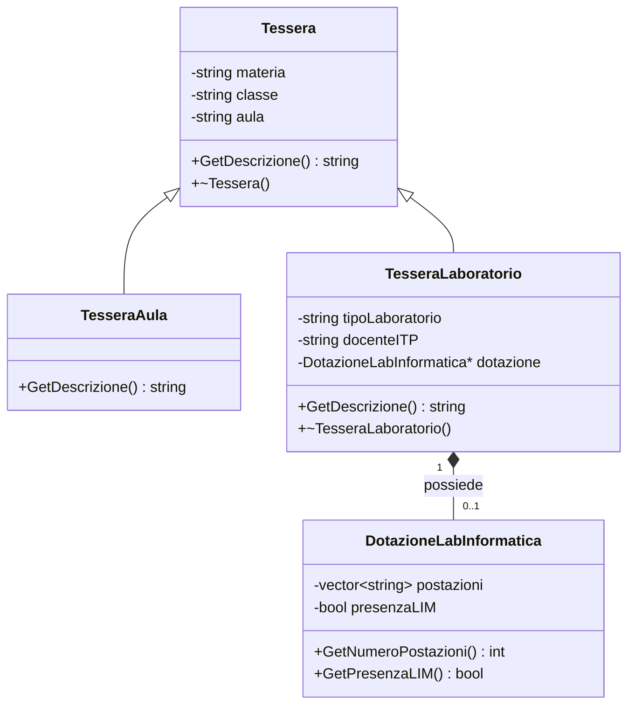

# P2-B — Ereditarietà, polimorfismo e memoria nelle tessere

**Seconda dispensa teorica P2.** Complementare alla [P2-A sui vincoli](P2_Dispensa_Teorica.md). Gli esempi corrispondono ai sorgenti di `OrarioDocenteCPP_P2/Model`.

## 1. Il problema

Una lezione può svolgersi in aula oppure in laboratorio. Entrambe condividono materia, classe e aula; le lezioni in laboratorio richiedono anche il tipo di laboratorio e il **docenteITP** (nome e cognome in una sola stringa). Soltanto un laboratorio di Informatica può avere una dotazione informatica con descrizione delle postazioni e presenza della LIM. Per Fisica, Chimica, Meccanica e altri laboratori la dotazione informatica è assente.

## 2. Modello delle classi

| Classe | Dati specifici |
|---|---|
| `Tessera` | `materia`, `classe`, `aula` (comuni) |
| `TesseraAula` | Nessun attributo aggiuntivo |
| `TesseraLaboratorio` | `tipoLaboratorio`, `docenteITP`, `DotazioneLabInformatica* dotazione` |
| `DotazioneLabInformatica` | `vector<string> postazioni`, `bool presenzaLIM` |



La freccia di generalizzazione esprime **ereditarietà** («è una»); il rombo pieno esprime **composizione**, cioè proprietà e durata dell'oggetto contenuto. Il collegamento `0..1` significa che la dotazione è facoltativa.

## 3. Classe base e distruttore virtuale

```cpp
class Tessera {
private:
    std::string materia, classe, aula;
public:
    Tessera(std::string materia, std::string classe, std::string aula);
    std::string GetMateria();
    std::string GetClasse();
    std::string GetAula();
    virtual std::string GetDescrizione();
    virtual ~Tessera();
};
```

La classe base è **concreta**: `GetDescrizione()` ha una propria implementazione. Diversamente, la classe `Vincolo` della P2-A è astratta perché dichiara metodi virtuali puri (`= 0`). La base può essere usata per leggere i dati comuni, mentre `GetDescrizione()` viene ridefinito dalle derivate con `override`.

```cpp
std::string Tessera::GetDescrizione() {
    return materia + " - " + classe + " - " + aula;
}
Tessera::~Tessera() {}
```

## 4. La tessera di aula

```cpp
class TesseraAula : public Tessera {
public:
    TesseraAula(std::string materia, std::string classe, std::string aula);
    std::string GetDescrizione() override;
};
```

```cpp
TesseraAula::TesseraAula(std::string materia, std::string classe, std::string aula)
    : Tessera(materia, classe, aula) {}
std::string TesseraAula::GetDescrizione() {
    return "AULA - " + Tessera::GetDescrizione();
}
```

La classe derivata richiama il costruttore della base; non deve duplicarne gli attributi.

## 5. La dotazione informatica: un oggetto strutturato

```cpp
class DotazioneLabInformatica {
private:
    std::vector<std::string> postazioni;
    bool presenzaLIM;
public:
    DotazioneLabInformatica(std::vector<std::string> postazioni, bool presenzaLIM);
    int GetNumeroPostazioni();
    std::string GetDescrizionePostazione(int indice);
    bool GetPresenzaLIM();
};
```

Il costruttore inizializza vettore e booleano. Il numero di postazioni **non è un attributo duplicato**: si ottiene da `postazioni.size()`. Il metodo `GetDescrizionePostazione` controlla l'indice e restituisce la descrizione o una stringa vuota se l'indice è errato. Il vettore e le stringhe liberano automaticamente le risorse quando viene distrutto l'oggetto dotazione.

## 6. La tessera di laboratorio

```cpp
class TesseraLaboratorio : public Tessera {
private:
    std::string tipoLaboratorio;
    std::string docenteITP;
    DotazioneLabInformatica* dotazione;
public:
    TesseraLaboratorio(std::string materia, std::string classe, std::string aula,
                       std::string tipoLaboratorio, std::string docenteITP,
                       DotazioneLabInformatica* dotazione);
    ~TesseraLaboratorio() override;
    TesseraLaboratorio(const TesseraLaboratorio&) = delete;
    TesseraLaboratorio& operator=(const TesseraLaboratorio&) = delete;
    std::string GetTipoLaboratorio();
    std::string GetDocenteITP();
    DotazioneLabInformatica* GetDotazione();
    std::string GetDescrizione() override;
};
```

Il costruttore inizializza la parte `Tessera` e memorizza `tipoLaboratorio`, `docenteITP` e il puntatore ricevuto. Il contratto è che **la tessera acquisisce la proprietà esclusiva** della dotazione non nulla. Il getter restituisce soltanto un puntatore per la consultazione: il chiamante non deve eseguire `delete`.

```cpp
TesseraLaboratorio::~TesseraLaboratorio() {
    delete dotazione;
}
```

`delete nullptr` è consentito e non fa nulla. Perciò lo stesso distruttore funziona per Informatica, Fisica, Chimica e Meccanica. Il campo `tipoLaboratorio` indica il tipo: non bisogna dedurlo dalla sola presenza del puntatore.

## 7. Esempi di creazione e polimorfismo

```cpp
Tessera* aula = new TesseraAula("Matematica", "4AI", "A12");
Tessera* informatica = new TesseraLaboratorio(
    "Informatica", "4AI", "LAB-INF", "Informatica", "Mario Rossi",
    new DotazioneLabInformatica({"PC docente", "PC Windows", "PC Linux"}, true));
Tessera* fisica = new TesseraLaboratorio(
    "Fisica", "4AI", "LAB-FIS", "Fisica", "Anna Bianchi", nullptr);

std::cout << aula->GetDescrizione() << "\\n";
std::cout << informatica->GetDescrizione() << "\\n";
std::cout << fisica->GetDescrizione() << "\\n";

delete aula;
delete informatica;
delete fisica;
```

Il tipo statico è sempre `Tessera*`, ma il tipo concreto degli oggetti è differente. La chiamata virtuale esegue la versione di `GetDescrizione()` corrispondente all'oggetto effettivo. I metodi specifici, come `GetDotazione()`, non sono accessibili direttamente tramite un `Tessera*`.

## 8. La sequenza di distruzione e lo stato della memoria

```text
Orario
  celle[0][0] ---> TesseraLaboratorio (heap)
                         |
                         +-- dotazione ---> DotazioneLabInformatica (heap)
                                               |
                                               +-- vector<string> postazioni
```

Quando `Orario::~Orario()` esegue `delete celle[0][0]`, il distruttore **virtuale** della base permette di eseguire `~TesseraLaboratorio()`, che libera la dotazione con `delete dotazione`. La distruzione di `DotazioneLabInformatica` distrugge il suo vettore e le stringhe. Infine si distrugge la parte base `Tessera`. Senza distruttore virtuale, eliminare un oggetto derivato tramite un puntatore alla base comporta **comportamento indefinito**, non semplicemente la mancata chiamata di un distruttore.

La copia predefinita della tessera di laboratorio copierebbe soltanto l'indirizzo `dotazione`, creando due proprietari dello stesso oggetto e rischiando una doppia deallocazione. Per questa fase la copia e l'assegnazione sono vietate con `= delete`. La copia profonda è un possibile approfondimento successivo.

## 9. Integrazione con Orario e responsabilità

La matrice resta `Tessera* celle[5][8]`: può contenere puntatori a tutte le classi derivate. `ScambiaCelle` scambia i puntatori senza perdere il tipo concreto. `Orario::Get` restituisce un puntatore **non proprietario**. `Orario::Set` acquisisce la proprietà della tessera **solo se restituisce true**:

```cpp
Tessera* nuova = new TesseraAula("Matematica", "4AI", "A12");
if (!orario.Set(Posizione(0, 0), nuova))
    delete nuova;
```

Se la tessera rifiutata fosse di laboratorio, il `delete` tramite `Tessera*` libererebbe anche l'eventuale dotazione. Nel modello didattico la dotazione è **di proprietà della singola tessera**: non condividere lo stesso puntatore tra più tessere. Nella realtà le dotazioni appartengono agli ambienti fisici; questa è una semplificazione intenzionale per studiare proprietà e distruzione.

## 10. Confronto con i vincoli P2-A

| Vincoli | Tessere |
|---|---|
| Base astratta `Vincolo` | Base concreta `Tessera` |
| `Verifica()` e `GetMessaggio()` virtuali puri | `GetDescrizione()` virtuale con implementazione |
| Il motore non possiede i vincoli | L'orario possiede le tessere |
| Distruttore virtuale per sicurezza dell'interfaccia | Distruttore virtuale necessario per il `delete` polimorfico |
| Regole di validazione differenti | Tipologie di lezione differenti |

## 11. Domande di ripasso

1. Perché `docenteITP` è un attributo unico e non due stringhe separate?
2. Perché `DotazioneLabInformatica` è opzionale e quando vale `nullptr`?
3. Perché il numero delle postazioni non è memorizzato in un secondo attributo?
4. Qual è la differenza tra ereditarietà e composizione nel diagramma?
5. Quale sequenza di distruttori viene eseguita da `delete` tramite `Tessera*`?
6. Che cosa rischia una copia superficiale del puntatore `dotazione`?
7. Perché `Orario::ScambiaCelle` non deve conoscere i tipi concreti delle tessere?
8. Che cosa succede se `Orario::Set` rifiuta una tessera appena allocata?

**Codice:** [Model](../../OrarioDocenteCPP_P2/Model/) · [P2-A](P2_Dispensa_Teorica.md).
