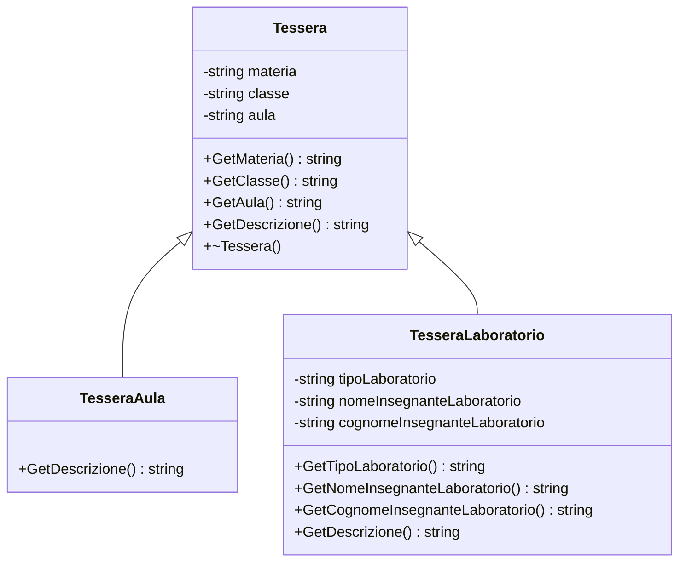

# P2 — Seconda dispensa teorica: ereditarietà e polimorfismo nelle tessere

## 1. Un secondo problema concreto

Nel programma attuale ogni cella occupata contiene una `Tessera`, che descrive una lezione mediante **materia**, **classe** e **aula**. Tuttavia non tutte le lezioni sono dello stesso tipo:

- una **lezione in aula** utilizza una normale aula;
- una **lezione in laboratorio** richiede anche il **tipo di laboratorio** e il **nome e cognome dell'insegnante di laboratorio** (docente tecnico-pratico, se previsto).

Vogliamo mantenere un solo orario, senza creare due matrici separate e senza ripetere inutilmente i dati comuni.

**Obiettivo:** comprendere come usare una classe base `Tessera` e due classi derivate, `TesseraAula` e `TesseraLaboratorio`.

Questa dispensa propone una **possibile evoluzione**, non descrive una modifica già realizzata nei sorgenti P2.

## 2. Individuare ciò che è comune e ciò che cambia

| Informazione | TesseraAula | TesseraLaboratorio |
|---|---|---|
| Materia | Sì | Sì |
| Classe | Sì | Sì |
| Nome dell'aula / laboratorio | Sì | Sì |
| Tipo di laboratorio | No | Sì |
| Nome e cognome dell'insegnante di laboratorio | No | Sì |

La classe base conserva le tre informazioni comuni. La classe derivata `TesseraLaboratorio` aggiunge solo quelle specifiche. `TesseraAula` non necessita di nuovi attributi, ma rappresenta esplicitamente il tipo di lezione.

**Esempio:** una tessera di aula può indicare «Matematica, 4AI, aula 12»; una tessera di laboratorio può indicare «Informatica, 4AI, laboratorio INF2, tipo Informatica, insegnante di laboratorio Mario Rossi».

## 3. Diagramma delle classi



La freccia indica **ereditarietà**: una `TesseraLaboratorio` **è una** `Tessera`, ma possiede informazioni aggiuntive.

## 4. La classe base: Tessera.h

Nella versione P2 già pubblicata `Tessera` non è polimorfica: non possiede metodi virtuali. Per questa evoluzione introduciamo un metodo `virtual` per descrivere la lezione e un **distruttore virtuale**.

```cpp
#pragma once
#include <string>

class Tessera {
private:
    std::string materia;
    std::string classe;
    std::string aula;

public:
    Tessera(std::string materia, std::string classe, std::string aula);
    std::string GetMateria();
    std::string GetClasse();
    std::string GetAula();

    virtual std::string GetDescrizione();
    virtual ~Tessera();
};
```

La base **non è astratta**, perché `GetDescrizione()` ha una propria implementazione. Questo è diverso dalla classe `Vincolo`, nella quale `Verifica()` e `GetMessaggio()` sono virtuali puri (`= 0`).

**Tessera.cpp** (si conservano il costruttore e i getter già esistenti; si aggiungono):

```cpp
std::string Tessera::GetDescrizione() {
    return materia + " - " + classe + " - " + aula;
}

Tessera::~Tessera() {}
```

## 5. Una tessera per le lezioni in aula

**TesseraAula.h**

```cpp
#pragma once
#include "Tessera.h"

class TesseraAula : public Tessera {
public:
    TesseraAula(std::string materia, std::string classe, std::string aula);
    std::string GetDescrizione() override;
};
```

**TesseraAula.cpp**

```cpp
#include "TesseraAula.h"

TesseraAula::TesseraAula(std::string materia, std::string classe, std::string aula)
    : Tessera(materia, classe, aula) {}

std::string TesseraAula::GetDescrizione() {
    return "AULA - " + Tessera::GetDescrizione();
}
```

La sintassi `: Tessera(materia, classe, aula)` richiama il costruttore della classe base. `Tessera::GetDescrizione()` richiama **esplicitamente** l'implementazione della classe base, evitando di ripetere la composizione delle informazioni comuni.

## 6. Una tessera per le lezioni in laboratorio

Per rappresentare con chiarezza nome e cognome, usiamo due attributi distinti.

**TesseraLaboratorio.h**

```cpp
#pragma once
#include "Tessera.h"

class TesseraLaboratorio : public Tessera {
private:
    std::string tipoLaboratorio;
    std::string nomeInsegnanteLaboratorio;
    std::string cognomeInsegnanteLaboratorio;

public:
    TesseraLaboratorio(std::string materia, std::string classe, std::string aula,
                       std::string tipoLaboratorio, std::string nome, std::string cognome);
    std::string GetTipoLaboratorio();
    std::string GetNomeInsegnanteLaboratorio();
    std::string GetCognomeInsegnanteLaboratorio();
    std::string GetDescrizione() override;
};
```

**TesseraLaboratorio.cpp**

```cpp
#include "TesseraLaboratorio.h"

TesseraLaboratorio::TesseraLaboratorio(
    std::string materia, std::string classe, std::string aula,
    std::string tipoLaboratorio, std::string nome, std::string cognome)
    : Tessera(materia, classe, aula),
      tipoLaboratorio(tipoLaboratorio),
      nomeInsegnanteLaboratorio(nome),
      cognomeInsegnanteLaboratorio(cognome) {}

std::string TesseraLaboratorio::GetTipoLaboratorio() {
    return tipoLaboratorio;
}

std::string TesseraLaboratorio::GetNomeInsegnanteLaboratorio() {
    return nomeInsegnanteLaboratorio;
}

std::string TesseraLaboratorio::GetCognomeInsegnanteLaboratorio() {
    return cognomeInsegnanteLaboratorio;
}

std::string TesseraLaboratorio::GetDescrizione() {
    return "LABORATORIO - " + Tessera::GetDescrizione() +
           " - tipo: " + tipoLaboratorio +
           " - insegnante di laboratorio: " +
           nomeInsegnanteLaboratorio + " " + cognomeInsegnanteLaboratorio;
}
```

I campi privati della base non sono accessibili direttamente dalla derivata: per leggere i dati comuni usiamo il metodo pubblico `Tessera::GetDescrizione()`. Il costruttore della derivata inizializza prima la parte base e poi i propri attributi.

## 7. Il polimorfismo: stesso puntatore, comportamento differente

```cpp
Tessera* prima = new TesseraAula("Matematica", "4AI", "12");
Tessera* seconda = new TesseraLaboratorio(
    "Informatica", "4AI", "INF2", "Informatica", "Mario", "Rossi");

std::cout << prima->GetDescrizione() << "\n";
std::cout << seconda->GetDescrizione() << "\n";

delete prima;
delete seconda;
```

Il tipo **statico** di entrambi i puntatori è `Tessera*`, ma gli oggetti effettivi sono diversi. La chiamata a `GetDescrizione()` seleziona a runtime l'implementazione corretta, grazie a `virtual` nella base e a `override` nelle derivate.

Un puntatore `Tessera*` può utilizzare i metodi dichiarati in `Tessera`, ma **non** può chiamare direttamente `GetTipoLaboratorio()`, che appartiene solo alla classe derivata.

## 8. Collegamento alla matrice dell'orario

L'attuale `Orario` possiede una matrice:

```cpp
Tessera* celle[5][8];
```

La matrice **non deve cambiare tipo** per ospitare oggetti derivati. Anche il metodo `Set(Posizione, Tessera*)` può ricevere puntatori a `TesseraAula` e `TesseraLaboratorio`.

```cpp
orario.Set(Posizione(0, 0),
           new TesseraAula("Matematica", "4AI", "12"));

orario.Set(Posizione(0, 1),
           new TesseraLaboratorio("Informatica", "4AI", "INF2",
                                 "Informatica", "Mario", "Rossi"));
```

**Attenzione alla proprietà:** `Set` acquisisce la proprietà del puntatore **soltanto quando restituisce `true`**. Se `Set` fallisce, il chiamante deve eliminare l'oggetto creato per evitare una perdita di memoria. Per esempio:

```cpp
Tessera* nuova = new TesseraAula("Matematica", "4AI", "12");
if (!orario.Set(Posizione(0, 0), nuova))
    delete nuova;
```

Il distruttore di `Orario` già esegue `delete celle[giorno][ora]`. Per distruggere correttamente anche la parte specifica degli oggetti derivati, il distruttore di `Tessera` **deve essere virtuale**.

Il metodo `ScambiaCelle` scambia puntatori, quindi conserva il tipo reale e tutte le informazioni degli oggetti senza copiarli.

## 9. Visualizzare tessere differenti senza conoscere il tipo concreto

La console attuale legge `GetMateria()`, `GetClasse()` e `GetAula()`. In una futura versione può usare il metodo virtuale comune:

```cpp
Tessera* tessera = orario.Get(posizione);
if (tessera == nullptr)
    std::cout << "Cella vuota\n";
else
    std::cout << tessera->GetDescrizione() << "\n";
```

Non servono due matrici, né una catena di `if` che distingua manualmente le tessere. Aggiungere una nuova tipologia di tessera richiede una nuova classe derivata, senza modificare il codice di visualizzazione che usa `GetDescrizione()`.

## 10. Confronto con il polimorfismo dei vincoli

| Vincoli | Tessere |
|---|---|
| Base: `Vincolo` | Base: `Tessera` |
| Base astratta | Base concreta |
| `Verifica()` e `GetMessaggio()` virtuali puri | `GetDescrizione()` virtuale con implementazione |
| Il motore conserva `Vincolo*` non proprietari | L'orario conserva `Tessera*` di cui è proprietario |
| Ogni derivata verifica una regola | Ogni derivata descrive una lezione |
| I vincoli vivono nella console | Le tessere vengono distrutte dall'orario |

Il principio comune è: **programmare rispetto a un'interfaccia condivisa, lasciando agli oggetti concreti la scelta del comportamento**.

## 11. Domande di verifica

1. Quali attributi devono stare nella classe base e quali solo in `TesseraLaboratorio`?
2. Perché `TesseraAula` può ereditare senza aggiungere attributi?
3. Perché `GetDescrizione()` è `virtual`? Che cosa accadrebbe senza `virtual`?
4. Perché il distruttore di `Tessera` deve essere `virtual`?
5. Perché `Tessera*` può indicare una `TesseraLaboratorio`, ma non permette di chiamare direttamente `GetTipoLaboratorio()`?
6. Che cosa succede alla memoria se `Set` rifiuta una tessera appena creata con `new`?
7. Perché lo scambio di due celle conserva anche il tipo concreto delle tessere?
8. Qual è la differenza tra una classe base astratta come `Vincolo` e una classe base concreta come `Tessera`?

**Collegamenti:** [prima dispensa P2](P2_Dispensa_Teorica.md) · [codice Tessera attuale](../../OrarioDocenteCPP_P2/Model/Tessera.h) · [codice Orario attuale](../../OrarioDocenteCPP_P2/Model/Orario.h).
