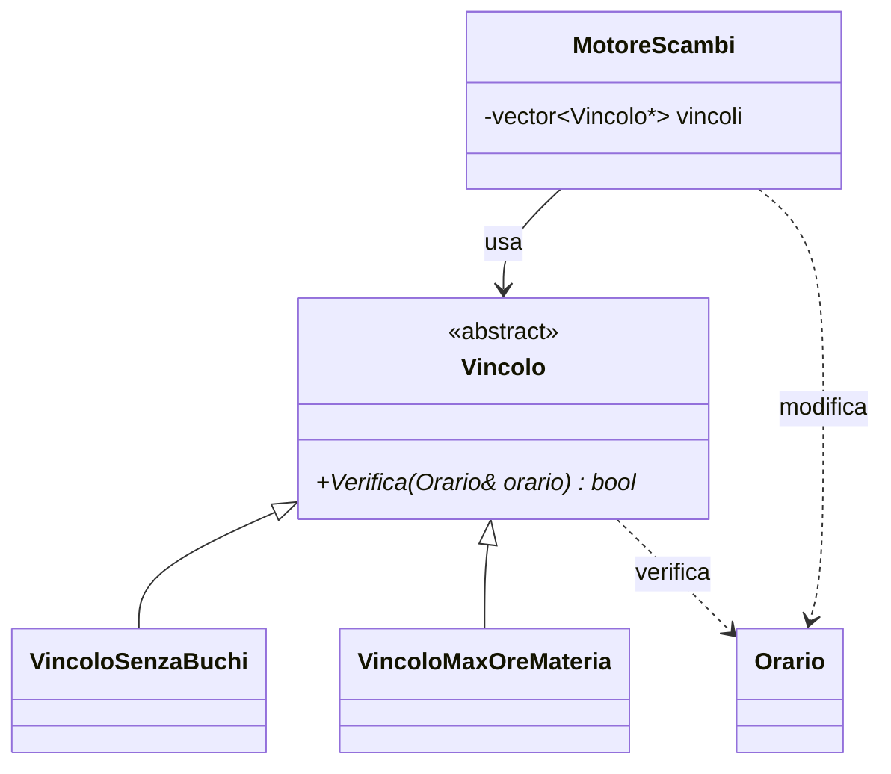

# P2 — Soluzioni commentate degli esercizi autonomi

**Documento per il docente — quarta Informatica**  
**Riferimento:** [P2_Esercizi.md](P2_Esercizi.md)  
**Stato:** soluzioni ragionate basate sulle interfacce P2; compilazione ed esecuzione del prototipo non ancora verificate in Visual Studio.

## Soluzione A — Responsabilità e relazioni UML

1. `Vincolo` definisce il comportamento comune.
2. `VincoloSenzaBuchi` e `VincoloMaxOreMateria` contengono gli algoritmi specifici.
3. `MotoreScambi` conferma lo scambio oppure lo annulla.
4. Il motore non dovrebbe cambiare a ogni nuovo vincolo: il polimorfismo permette di chiamare sempre `Verifica()`.
5. Schema UML:



Il motore conserva puntatori non proprietari a oggetti `Vincolo`. Le classi concrete ereditano dalla base astratta.

## Soluzione B — Classe astratta corretta

```cpp
#pragma once
#include "../Model/Orario.h"

class Vincolo {
public:
    virtual bool Verifica(Orario& orario) = 0;
    virtual ~Vincolo() {}
};
```

Mancava `virtual` davanti a `Verifica`: `= 0` è consentito per un metodo virtuale puro. Anche il distruttore deve essere virtuale per consentire una distruzione corretta tramite puntatore alla classe base. Non si può dichiarare `Vincolo v;`, perché la classe contiene un metodo virtuale puro e non è istanziabile.

## Soluzione C — Polimorfismo

| Espressione | Tipo del puntatore | Tipo dell'oggetto | Metodo eseguito |
|---|---|---|---|
| `primo->Verifica(orario)` | `Vincolo*` | `VincoloSenzaBuchi` | `VincoloSenzaBuchi::Verifica` |
| `secondo->Verifica(orario)` | `Vincolo*` | `VincoloMaxOreMateria` | `VincoloMaxOreMateria::Verifica` |

`x` e `y` non devono essere uguali: un orario può non avere buchi ma superare il massimo per materia, oppure rispettare il massimo per materia ma contenere buchi.

## Soluzione D — VincoloMaxOreMateria

**VincoloMaxOreMateria.h**

```cpp
#pragma once
#include "Vincolo.h"

class VincoloMaxOreMateria : public Vincolo {
private:
    int massimoOre;
public:
    VincoloMaxOreMateria(int massimoOre);
    bool Verifica(Orario& orario) override;
};
```

**VincoloMaxOreMateria.cpp**

```cpp
#include "VincoloMaxOreMateria.h"

VincoloMaxOreMateria::VincoloMaxOreMateria(int massimoOre)
    : massimoOre(massimoOre) {}

bool VincoloMaxOreMateria::Verifica(Orario& orario) {
    if (massimoOre < 0 || massimoOre > 8)
        return false;

    // Esamina ogni giorno della settimana.
    for (int giorno = 0; giorno < 5; giorno++) {

        // Sceglie una tessera come materia da controllare.
        for (int ora = 0; ora < 8; ora++) {
            Tessera* tessera = orario.Get(Posizione(giorno, ora));
            if (tessera == nullptr)
                continue;

            int conteggio = 0;

            // Conta le lezioni della stessa materia nel giorno.
            for (int altraOra = 0; altraOra < 8; altraOra++) {
                Tessera* altra = orario.Get(Posizione(giorno, altraOra));
                if (altra != nullptr &&
                    altra->GetMateria() == tessera->GetMateria()) {
                    conteggio++;
                }
            }

            // Basta una materia oltre il limite per rifiutare.
            if (conteggio > massimoOre)
                return false;
        }
    }

    return true;
}
```

**Spiegazione:** il primo ciclo sceglie il giorno; il secondo seleziona una materia presente; il terzo conta le tessere con quella materia nello stesso giorno. È possibile ricontare una materia più volte, ma con 8 ore al giorno il costo è modesto e l'algoritmo resta semplice. I puntatori nulli vengono controllati prima di usare `GetMateria()`.

## Soluzione E — Esiti del vincolo

| Caso | Esito `VincoloMaxOreMateria(2)` | Motivazione |
|---|---|---|
| A | `true` | INF compare due volte |
| B | `false` | INF compare tre volte |
| C | `true` | INF e MAT compaiono due volte, ING una |
| D | `false` | MAT compare tre volte |
| E | `true` | INF compare due volte |

Il caso E contiene una cella vuota fra due lezioni, ma **questo vincolo** conta soltanto le lezioni della stessa materia. Sarà `VincoloSenzaBuchi` a rifiutare quel giorno.

## Soluzione F — Ciclo polimorfico

```cpp
bool MotoreScambi::VerificaVincoli(Orario& orario) {
    if (vincoli.empty())
        return false;

    for (int i = 0; i < static_cast<int>(vincoli.size()); i++) {
        if (!vincoli[i]->Verifica(orario))
            return false;
    }

    return true;
}
```

Non si possono creare oggetti `Vincolo` per valore perché la classe è astratta. Il vettore contiene puntatori alla classe base che possono riferirsi a oggetti di classi derivate diverse. Il metodo `Verifica()` è virtuale: viene scelto in base al tipo effettivo dell'oggetto, senza controlli manuali sul suo tipo.

## Soluzione G — Durata degli oggetti

La variabile locale `limite` viene distrutta quando termina `Configura`. Il puntatore conservato nel motore diventa **pendente** (dangling pointer) e non può più essere utilizzato in sicurezza.

Una soluzione è conservare il vincolo in un oggetto che vive abbastanza a lungo, per esempio nella console:

```cpp
class InterfacciaConsole {
private:
    VincoloMaxOreMateria limite;
    MotoreScambi motore;
public:
    InterfacciaConsole() : limite(2) {
        motore.AggiungiVincolo(&limite);
    }
};
```

Questo frammento è **illustrativo**: nella soluzione reale il costruttore della console riceve anche `Orario&` e `ElencoAule&`. L'ordine degli attributi assicura che `limite` venga costruito prima di `motore` e distrutto dopo di esso.

Il motore non chiama `delete` perché non ha creato `limite` con `new` e non ne possiede la memoria.

## Soluzione H — Scambi e ripristino

Ogni prova riparte dall'orario iniziale.

| Scambio | Esito | Motivo | Celle dopo la prova |
|---|---|---|---|
| Lun 1 ↔ Lun 2 | Accettato | Nessun buco; nessuna materia supera 2 ore | Lun 1 = MAT, Lun 2 = INF |
| Lun 2 ↔ Mar 3 | Rifiutato | Lun 2 diventa vuota fra due lezioni | Lun 2 = MAT, Mar 3 = vuota |
| Lun 3 ↔ Mar 3 | Accettato | Lunedì resta con due lezioni consecutive; martedì ne ha tre consecutive | Lun 3 = vuota, Mar 3 = ING |

Nessuna delle tre prove supera il limite per materia. Nel secondo caso lo scambio viene effettuato temporaneamente, ma poi annullato: **lo stato finale coincide con quello iniziale**.

## Soluzione I — Nuovo vincolo

**VincoloPrimaOraLibera.h**

```cpp
#pragma once
#include "Vincolo.h"

class VincoloPrimaOraLibera : public Vincolo {
public:
    bool Verifica(Orario& orario) override;
    std::string GetMessaggio() override;
};
```

**VincoloPrimaOraLibera.cpp**

```cpp
#include "VincoloPrimaOraLibera.h"

bool VincoloPrimaOraLibera::Verifica(Orario& orario) {
    for (int giorno = 0; giorno < 5; giorno++) {
        if (orario.Get(Posizione(giorno, 0)) != nullptr)
            return false;
    }
    return true;
}
```

Implementazione del messaggio richiesta dalla classe astratta:

```cpp
std::string VincoloPrimaOraLibera::GetMessaggio() {
    return "la prima ora deve essere libera";
}
```

Registrazione, con oggetto dalla durata sufficiente:

```cpp
VincoloPrimaOraLibera primaOraLibera;
motore.AggiungiVincolo(&primaOraLibera);
```

Per supportare il nuovo vincolo non serve modificare **né `VerificaVincoli()` né `Scambia()`**. Occorre invece creare l'oggetto, registrarlo e aggiungere i nuovi file al progetto Visual Studio.

## Soluzione L — Piano di collaudo esemplificativo

I risultati seguenti sono **attesi**, non risultati di test eseguiti.

| Test | Stato iniziale / operazione | Risultato atteso |
|---|---|---|
| T01 | Giorno con INF, MAT, INF consecutive; limite materia 2 | Entrambi i vincoli `true` |
| T02 | Giorno con INF, vuoto, MAT | `VincoloSenzaBuchi` = `false` |
| T03 | Giorno con INF, INF, INF; limite materia 2 | `VincoloMaxOreMateria` = `false` |
| T04 | Da orario valido, scambio fra due celle occupate adiacenti | Scambio accettato, se gli altri vincoli restano rispettati |
| T05 | Da orario valido, scambio che crea un vuoto interno | Scambio rifiutato e orario ripristinato |
| T06 | Motore con vettore dei vincoli vuoto | Scambio rifiutato, orario invariato |

Per T04 e T05 occorre documentare le posizioni e le tessere effettive. Per il vincolo sulle materie è utile aggiungere un caso in cui un trasferimento tra giorni porta una materia da due a tre lezioni in un giorno.

La colonna **risultato osservato** può essere compilata soltanto dopo l'esecuzione dei test.

## Indicazioni per la correzione

| Esercizi | Punti | Elementi essenziali |
|---|---:|---|
| A–C | 6 | Responsabilità, classe astratta, dispatch virtuale |
| D–E | 6 | Conteggio per giorno e materia, gestione `nullptr`, esiti |
| F–G | 4 | Ciclo polimorfico, puntatori non proprietari, durata |
| H–L | 4 | Ripristino, nuovo vincolo senza modificare il motore, test |
| **Totale** | **20** | |

**Nota di revisione:** queste soluzioni seguono l'API del prototipo P2 pubblicato. Se il successivo collaudo richiederà modifiche alle interfacce, aggiornare insieme esercizi, soluzioni e guida di laboratorio.

## Soluzione M — Comunicare il motivo del rifiuto

Nella classe astratta aggiungere `virtual std::string GetMessaggio() = 0;` (e `#include <string>`). Le classi derivate ridefiniscono il metodo, per esempio:

```cpp
std::string GetMessaggio() override {
    return "superato il massimo di ore della stessa materia";
}
```

Il motore modifica la firma di `VerificaVincoli` e `Scambia` aggiungendo `std::string& messaggio`. Nel ciclo:

```cpp
if (!vincoli[i]->Verifica(orario)) {
    messaggio = vincoli[i]->GetMessaggio();
    return false;
}
```

La console chiama `Scambia(orario, prima, seconda, messaggio)` e stampa il motivo in caso di rifiuto. Il motore deve comunque ripristinare le celle dopo uno scambio non valido.

## Soluzione N — Limite modificabile e messaggio aggiornato

**VincoloMaxOreMateria.h** (metodi da aggiungere alla classe):

```cpp
int GetMassimoOre();
void SetMassimoOre(int nuovoMassimo);
std::string GetMessaggio() override;
```

**VincoloMaxOreMateria.cpp** (implementazioni):

```cpp
int VincoloMaxOreMateria::GetMassimoOre() {
    return massimoOre;
}

void VincoloMaxOreMateria::SetMassimoOre(int nuovoMassimo) {
    if (nuovoMassimo >= 1 && nuovoMassimo <= 8)
        massimoOre = nuovoMassimo;
}

std::string VincoloMaxOreMateria::GetMessaggio() {
    return "superato il massimo di " + std::to_string(massimoOre) +
           " ore della stessa materia in un giorno";
}
```

**InterfacciaConsole.h** (metodo privato):

```cpp
void ModificaMassimoOreMateria();
```

**InterfacciaConsole.cpp** (esempio di nuova voce del menu, usando l'opzione 8 se libera):

```cpp
cout << "8 - Modifica massimo ore per materia (attuale: "
     << vincoloMaxOreMateria.GetMassimoOre() << ")\\n";
```

La scelta del menu deve accettare anche 8 e il relativo `switch` deve chiamare `ModificaMassimoOreMateria()`.

```cpp
void InterfacciaConsole::ModificaMassimoOreMateria() {
    cout << "Limite attuale: "
         << vincoloMaxOreMateria.GetMassimoOre() << "\\n";
    int nuovo = LeggiIntero("Nuovo limite (1-8): ", 1, 8);
    vincoloMaxOreMateria.SetMassimoOre(nuovo);
    cout << "Nuovo limite: "
         << vincoloMaxOreMateria.GetMassimoOre() << "\\n";
    if (!vincoloMaxOreMateria.Verifica(orario))
        cout << "Attenzione: l'orario attuale supera il limite.\\n";
}
```

**Risultati attesi:** con limite 3, tre lezioni della stessa materia sono consentite; con limite 2 non lo sono. L'input 0 o 9 viene respinto da `LeggiIntero` e richiesto nuovamente. Il messaggio contiene il limite aggiornato. Se l'orario di partenza è già non valido, il motore rifiuta gli scambi prima di effettuarli. Il valore modificato non viene salvato su file.
